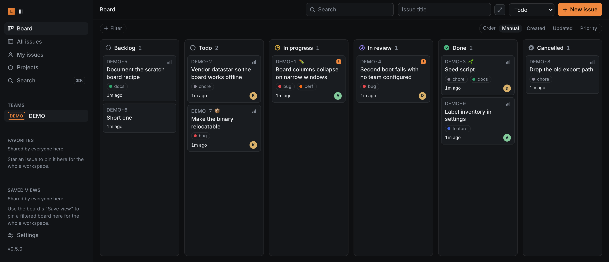

# lll

**Your next agent shouldn't start from scratch.**

lll keeps work, decisions and discoveries on a shared board. When a new
agent arrives, it can find the task, read what previous agents learned about
the code, and leave the reasoning behind its own changes.

You follow the work in a browser. Your agents use the CLI. One server keeps
the record available across sessions and machines.



## Why lll?

- **Keep the lessons with the work.** Findings are linked to the
  files they concern; decisions keep the reasoning with the work. An agent can
  check `lll finding near PATH` before repeating an investigation.
- **Coordinate who takes each task.** People and agents claim tasks so
  another worker can see what is taken.
- **See what happened.** Follow progress, comments and changes on the live
  board, then read the same record from the terminal.
- **Keep it yours.** One self-hosted binary includes the server, database and
  web board. Export the record as Markdown when you need it elsewhere.

[How the record helps your next agent](docs/working-with-agents.md).

## Install

```sh
brew install escherize/lll/lll
```

Other platforms: [download a release](https://github.com/escherize/lll/releases).

Linux Flatpak bundles: [installation and sandbox behavior](packaging/flatpak/README.md).

## Quickstart

Start a board in a project directory:

```sh
mkdir my-project && cd my-project
lll new "Payments rewrite"
```

Open the sign-in link it prints. Keep this terminal running; in a second
terminal, in the same directory, add a task:

```sh
lll issue create -t "Make sign-in errors easier to understand"
lll board -w
```

The board's data is saved, and this directory remembers where it belongs.
Run `lll new "Payments rewrite"` again to reopen it after stopping the server.

Already invited to a board, or connecting another machine or repository?
[Use that existing board](docs/setup.md#join-an-existing-board).

## Bring an agent

Give your agent its own identity on the board:

```sh
lll bot create bot-payments
```

The command prints a prompt to paste into your coding agent, including its
access token. Keep that prompt private. The agent can read and claim the task,
check what is already known about the code, then record what it changed and
learned. You follow the work on the same board.

Invite teammates as people, then let each person connect their own agents.
They can also follow a view-only board link in a browser without installing
anything. [Inviting and sharing](docs/inviting.md) explains the access choices.

To have an agent answer comments on a task, `lll issue watch KEY-12 --until
@agent` waits for one; `lll skill get lll` has the recipe under "Drive an
agent from an issue".

For a fuller optional workflow, `lll skill get software-factory` describes
claiming, isolating, building, verifying, merging and recording. Use it as a
starting point for your own process.

## Go further

- [Setup and sharing](docs/setup.md): connect a repository, invite people,
  share a board, or administer a server.
- [CLI guide](docs/cli-guide.md): everyday commands, configuration and automation.
- [Upgrading](docs/upgrading.md): update clients and servers and protect your data.
- [Development](docs/development.md): build, test and contribute.
- [Changelog](CHANGELOG.md) and [CLI contract](docs/cli-contract.md).

## License

[MIT](LICENSE).
