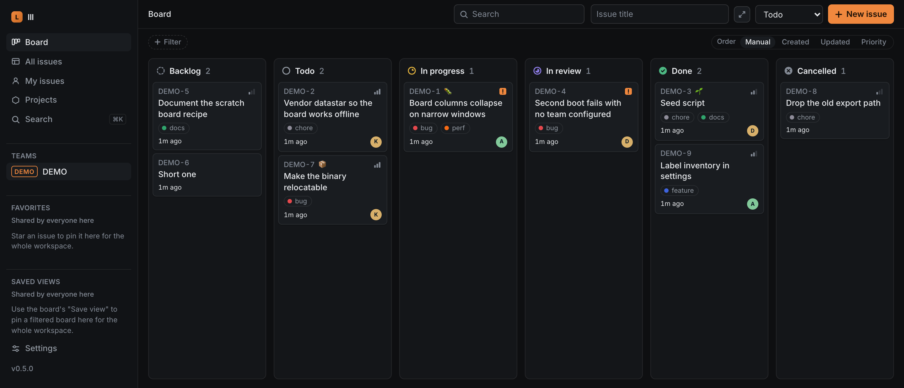

# lll

**An issue tracker for you and your coding agents.**

Give the work a home beyond the chat. lll keeps tasks, progress and decisions
on a shared board, so you can see what your agents are doing and the next
session can pick up where the last one stopped.

Use the web board to plan and review. Use the CLI to work from your terminal
or give an agent access to the same backlog. Changes appear live in both.



## Why lll?

- **Know who's working on what.** People and agents claim tasks before
  starting, so another worker can see the task is taken.
- **Keep the context with the work.** Comments, findings and decisions stay
  searchable alongside the issues they explain, across sessions and handoffs.
- **Move between planning and doing.** Drag cards on the board; create,
  update and comment on the same issues from the terminal. Scripts and agents
  can read structured JSON.
- **Run it yourself.** One binary includes the server, database and web board.
  Start locally, or host a shared board for your team.

## Install

```sh
brew install escherize/lll/lll
```

Other platforms: [download a release](https://github.com/escherize/lll/releases).

## Quickstart

Start a board for a project:

```sh
mkdir my-project && cd my-project
LLL_TEAM=APP lll up
```

On a fresh setup, lll creates your board and logs your CLI in. Open the
sign-in link it prints. Keep this terminal running; in a second terminal,
in the same directory, add some work:

```sh
lll issue create -t "Make sign-in errors easier to understand"
lll issue claim APP-1
lll issue comment APP-1 -b "Checking what happens with an expired link."
lll board -w
```

You'll see the task, its claim and your comment on the board. `APP` is the
project's team key; its issues are `APP-1`, `APP-2`, and so on. lll saves that
association in `.lll.toml`, so later commands know which backlog to use.

Already use lll on another server? [Connect to that board](docs/setup.md)
instead of starting a new one.

## Bring an agent

Give your agent its own identity on the board:

```sh
lll bot create bot-my-project
```

The command prints a prompt to paste into your coding agent, including its
access token. Keep that prompt private. Your agent can then read the backlog,
claim a task, leave progress notes and record what it learned. You follow the
work on the same board.

lll also includes agent instructions for that workflow: ask the agent to run
`lll skill get lll` to read them.

## Go further

- [Setup and sharing](docs/setup.md): connect a repository, invite people,
  share a board, or administer a server.
- [CLI guide](docs/cli-guide.md): everyday commands, configuration and automation.
- [Upgrading](docs/upgrading.md): update clients and servers and protect your data.
- [Development](docs/development.md): build, test and contribute.
- [Changelog](CHANGELOG.md) and [CLI contract](docs/cli-contract.md).

## License

[MIT](LICENSE).
